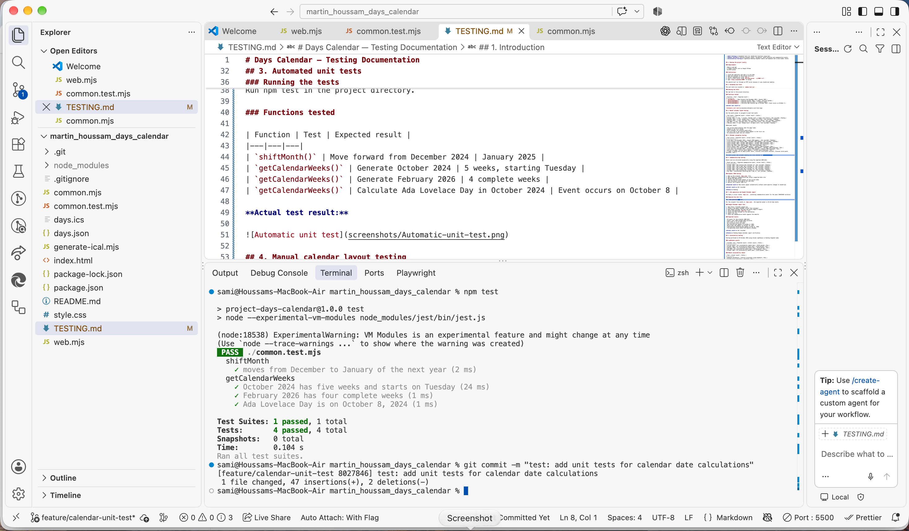
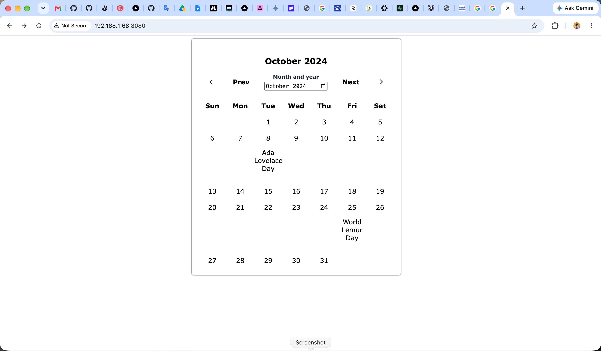
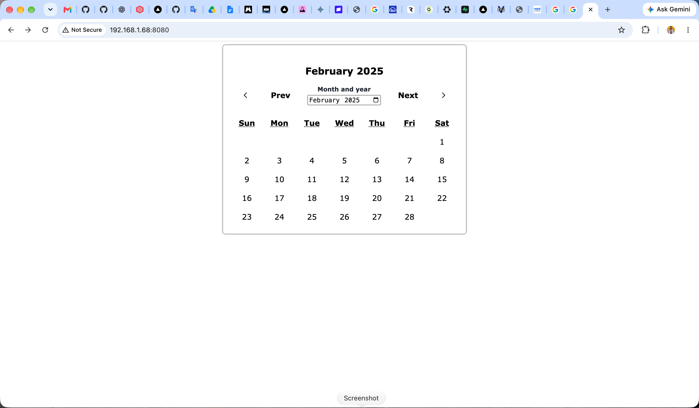
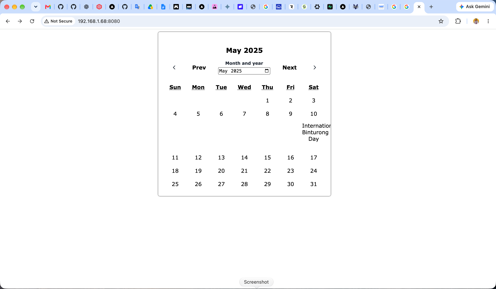
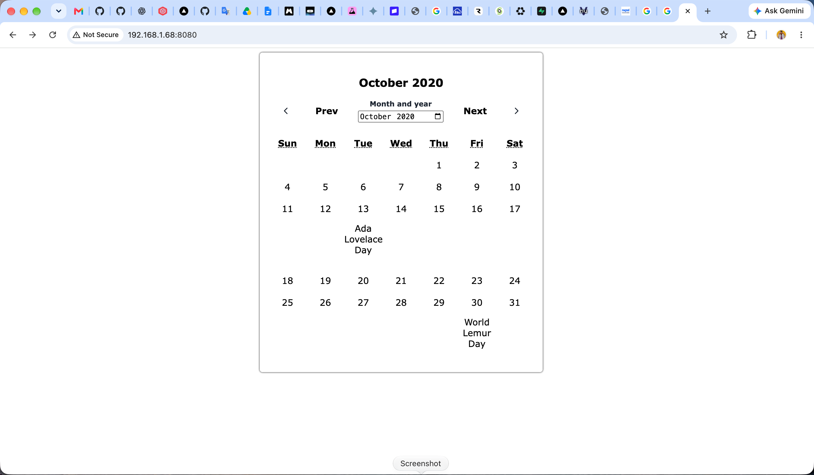
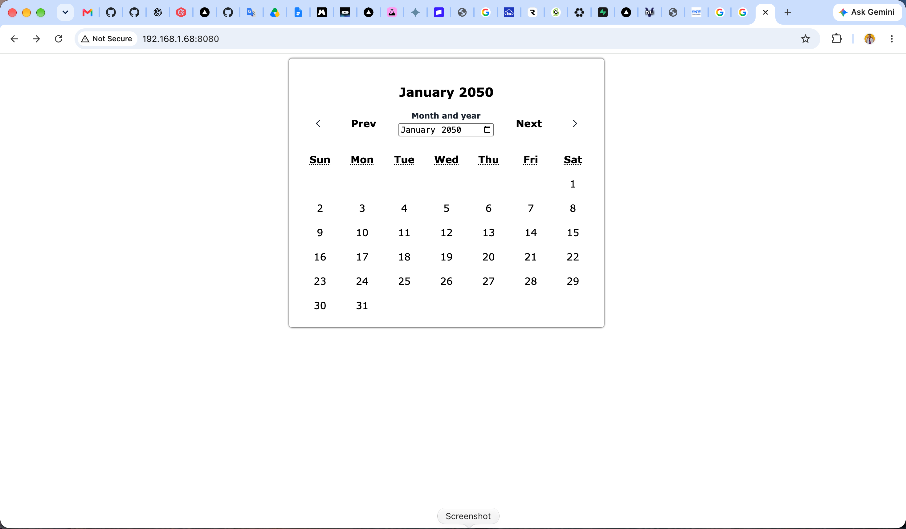
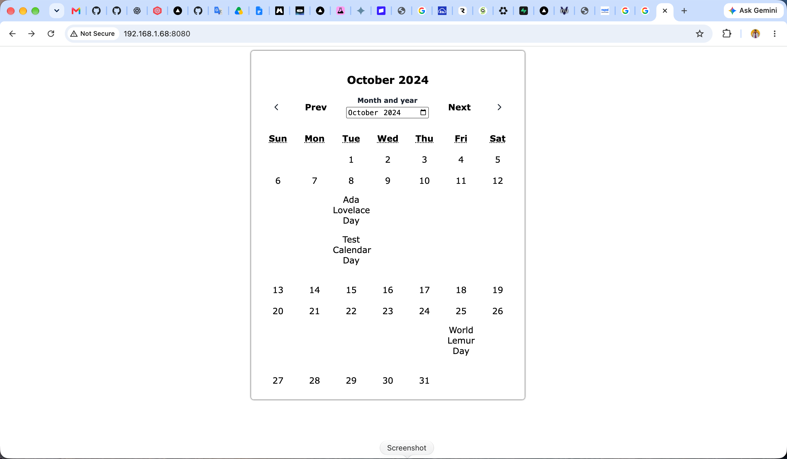
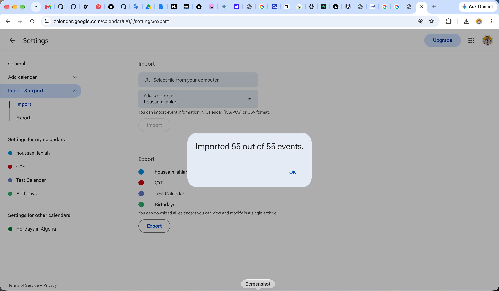
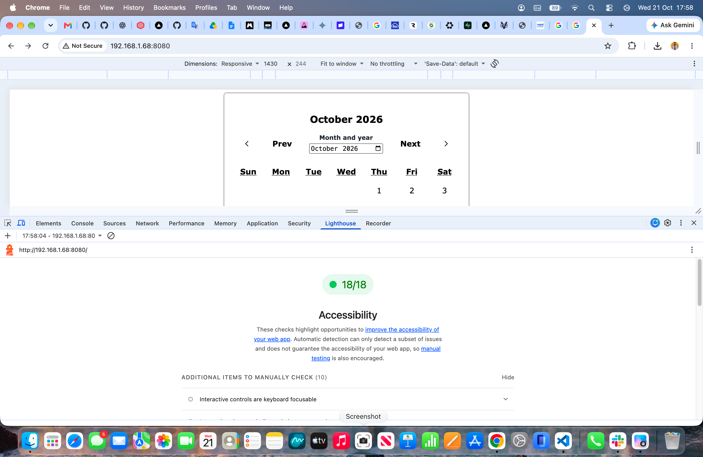

# Days Calendar — Testing Documentation

## 1. Introduction

This document describes how the Days Calendar project has been tested.

The project uses three testing methods:

- **Unit testing:** Automated tests for JavaScript functions using Jest.
- **Manual testing:** Checking calendar layout, navigation, month selection and commemorative events.
- **Accessibility testing:** Lighthouse Desktop Snapshot audits and keyboard and screen-reader checks.

## 2. Running the project locally

### Requirements

- Node.js and npm
- A modern browser such as Google Chrome
- An HTTP server

### Instructions

1. Clone the repository and open it in VS Code.
2. Open the terminal in the project directory.
3. Install dependencies using `npm ci`.
4. Start a local server using `npx http-server .`.
5. Open `http://localhost:8080` in Chrome.

The website must run through an HTTP server because it uses JavaScript modules.

## 3. Automated unit tests

The unit tests are located in `common.test.mjs`.

### Running the tests

Run npm test in the project directory.

### Functions tested

| Function | Test | Expected result |
|---|---|---|
| `shiftMonth()` | Move forward from December 2024 | January 2025 |
| `getCalendarWeeks()` | Generate October 2024 | 5 weeks, starting Tuesday |
| `getCalendarWeeks()` | Generate February 2026 | 4 complete weeks |
| `getCalendarWeeks()` | Calculate Ada Lovelace Day in October 2024 | Event occurs on October 8 |

**Command:** `npm test`

**Actual result:** 4 tests passed, 0 failed.

**Status:** PASS

## 4. Manual calendar layout testing

Using the month picker to navigate to each test month.

## 4.1. Test month : October 2024

**Expected result:** 5 rows, 7 columns, Tuesday start, 2 empty cells before

**Actual result:** Matches expected layout

**Status:** PASS 

**Status:** PASS 

## 4.2. Test month : December 2024

**Expected result:** 5 rows, Sunday start, 4 empty cells after

**Actual result:** Matches expected layout

**Status:** PASS 

## 4.3. Test month : February 2025

**Expected result:** 5 rows, Saturday start, 6 empty cells before

**Actual result:** Matches expected layout 

**Status:** PASS 

## 4.4. Test month : May 2025

**Expected result:** 5 rows, Thursday start, no empty cells after

**Actual result:** Matches expected layout

**Status:** PASS 

## 4.5. Test month : February 2026

**Expected result:** 4 rows, Sunday start, no empty cells

**Actual result:** Matches expected layout

**Status:** PASS 

Additional checks:

- The current month displays when the page loads.
- Sunday is the first column.
- Every calendar row contains seven cells.
- The first day of the selected month appears in the first row.
- No unnecessary week rows are created.

## 5. Calendar navigation testing

## 5.1. Test action : Select October 2020

**Expected result:** October 2020 displayed

**Actual result:** October 2020 displayed

**Status:** PASS 

## 5.2. Test action : Select October 2024

**Expected result:** October 2024 displayed

**Actual result:** October 2024 displayed

**Status:** PASS 

## 5.3. Test action : Select May 2030

**Expected result:** May 2030 displayed

**Actual result:** May 2030 displayed

**Status:** PASS 

## 5.4. Test action : Select January 2050

**Expected result:** January 2050 displayed

**Actual result:** January 2050 displayed

**Status:** PASS 

## 5.5. Test action : Previous from January 2050

**Expected result:** December 2049 displayed

**Actual result:** December 2049 displayed

**Status:** PASS 

[Watch Previous from January 2050 test](screenshots/09-previous-from-january-2050.mov)

## 5.6. Test action : Next from December 2049

**Expected result:** January 2050 displayed

**Actual result:** January 2050 displayed

**Status:** PASS 

[Watch Next from December 2049 test](screenshots/10-next-from-december-2049.mov)

## 5.7. Test action : Previous from January 2025

**Expected result:** December 2024 displayed

**Actual result:** December 2024 displayed

**Status:**  PASS 

[Watch Previous from January 2025 test](screenshots/11-previous-from-january-2025.mov)

## 5.8. Test action : Next from December 2024

**Expected result:** January 2025 displayed

**Actual result:** January 2025 displayed

**Status:**  PASS

[Watch Next from December 2024 test](screenshots/12-next-from-december-2024.mov)

## 5.9. Test action : Reload the page

**Expected result:** Current month displayed

**Actual result:** Current month displayed

**Status:** PASS 

[Watch reload page test](screenshots/13-reload-page.mov)

## 5.10. Test action : Trigger change with an empty month value

**Expected result:** Previous valid month restored

**Actual result:** Previous valid month restored

**Status:** PASS 

[Watch Previous valid month restored test](screenshots/14-previous-valid-month-restored.mov) 

## 6. Commemorative day testing

Events must be calculated dynamically using the supplied JSON data.

## 6.1. Test month : October 2020

**Expected result:** Ada Lovelace Day — 13 October + World Lemur Day — October 30

**Actual result:** Ada Lovelace Day — 13 October + World Lemur Day — October 30 

**Status:** PASS 

## 6.2. Test month : October 2024

**Expected result:** Ada Lovelace Day — October 8 + World Lemur Day — October 25

**Actual result:** Ada Lovelace Day — October 8 + World Lemur Day — October 25

**Status:** PASS 

## 6.3. Test month : October 2025

**Expected result:** Ada Lovelace Day — October 14

**Actual result:** Ada Lovelace Day — October 14

**Status:** PASS 

## 6.4. Test month : May 2030

**Expected result:** International Binturong Day — May 11

**Actual result:** International Binturong Day — May 11

**Status:** PASS 

## 6.5. Dynamic JSON testing

1. Open the original `days.json` file.
2. Add a temporary commemorative day for example:

{
  "name": "Test Calendar Day",
  "monthName": "October",
  "dayName": "Tuesday",
  "occurrence": "second",
  "descriptionURL": "https://codeyourfuture.github.io/Checkpoint/days/lemurs.txt"
}

3. Reload the application.
4. The event appears on the correct date.
5. Restore the original `days.json` file after testing.

**Expected result:** Both Ada Lovelace Day and Test Calendar Day appear on 8 October 2024.

**Actual result:** Both events displayed in the same calendar cell without changes to JavaScript.

**Status:** PASS

## 7. iCal generation and Google Calendar import

The Node.js script creates `days.ics`, containing commemorative events for the years 2020–2030 inclusive.

### 7.1. Generate the iCal file

Run `node generate-ical.mjs`.

For the original five events in `days.json`, the expected output is 55 all-day events.

### 7.2. Google Calendar import test

1. Open https://calendar.google.com.
2. Create a new empty calendar called "Test Calendar".
3. Open Google Calendar Settings and select Import & export.
4. Select the generated `days.ics` file.
5. Choose the Test Calendar as the destination.
6. Import the file.
7. Check the commemorative events against the website.

**Actual results:**

- 55 events for the original JSON data.

- Events cover 2020 through 2030 inclusive.

[Watch imported calendar events](screenshots/18-video-events.mov)

**Status:** PASS.

### 7.3. Recurrence test

**Command:** `grep -c '^RRULE' days.ics`

**Expected result:** 0 recurring event rules.

**Actual result:** 0.

**Status:** PASS

**Command:** grep -c '^DTSTART;VALUE=DATE:' days.ics

**Expected result:** 55.

**Actual result:** 55.

**Status:** PASS

## 8. Accessibility testing

Testing performed on 21 October 2026 using Chrome Lighthouse in Desktop Snapshot mode.

### Lighthouse results

| Calendar view | Actual result | Status |
|---|---|---|
| Current month | 18/18 audits passed | PASS |
| October 2024 | 18/18 audits passed | PASS |
| February 2026 | 18/18 audits passed | PASS |
| May 2030 | 18/18 audits passed | PASS |
| October 1900 | 18/18 audits passed | PASS |

### Manual accessibility checks

| View | Expected result | Actual result |
|---|---|---|---|
| Keyboard navigation | Controls accessible using keyboard | Pass |
| Visible focus indicators | Verified | Pass |
| Previous/Next accessible controls | Verified | Pass |
| Month picker accessibility | Verified | Pass |
| Screen reader — calendar dates | Readable and understandable | Pass |
| Screen reader — commemorative event names | Readable and understandable | Pass |

The manual checks were also completed successfully.

**Evidence:** Lighthouse Snapshot reports generated on 21 October 2026. 

[View Lighthouse accessibility report](screenshots/accessibility-report.pdf)

**Video evidence :**

[Watch manual accessibility checks](screenshots/20-manual-accessibility-checks.mov)
